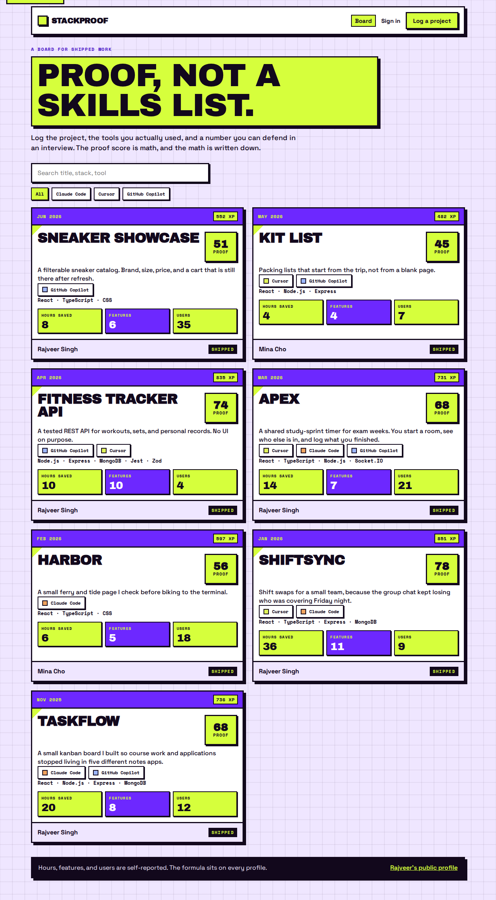
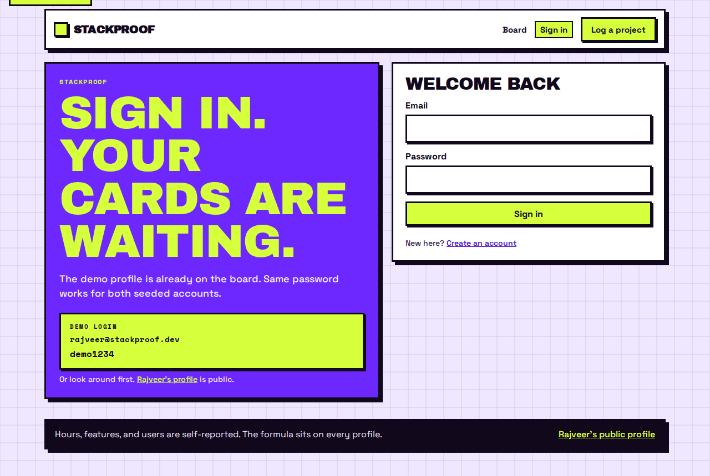
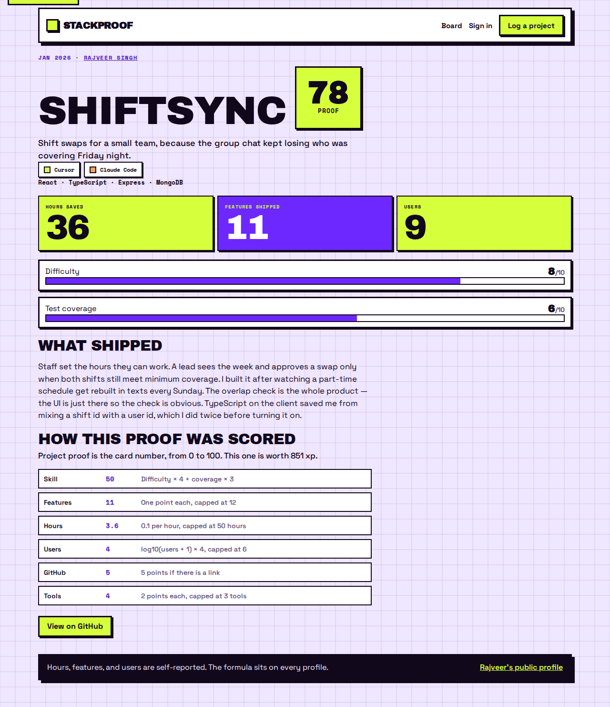
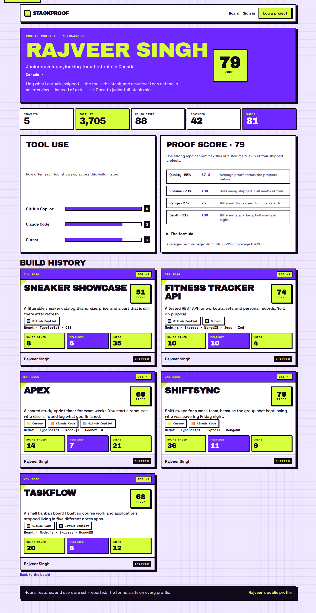
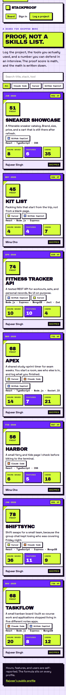

# StackProof

A board for shipped work. You log a project, the tools you actually used, and a few numbers. Each card gets a proof score and XP. Your public page at `/u/:username` rolls those into one proof score.

Rajveer Singh’s demo profile is the one to open in an interview.



## Demo login

| | |
| --- | --- |
| Email | `rajveer@stackproof.dev` |
| Password | `demo1234` |
| Profile | [/u/rajveer](http://localhost:43123/u/rajveer) |

Mina Cho (`mina@stackproof.dev`, same password) is on the board too, so the feed is not a single-person list.

Outcomes are self-reported. The math is on the profile and on each project page.

## Run it

```bash
git clone https://github.com/Rajveerrsingh/StackProof
cd StackProof
```

You need Node 22. MongoDB is optional. With no `MONGODB_URI`, the API keeps everything in memory and seeds the demo on startup.

```bash
cd server
npm install
npm run dev
```

```bash
cd client
npm install
npm run dev
```

- App: http://localhost:43123
- API: http://localhost:4721

### Docker

```bash
docker compose up --build
```

That starts MongoDB, the API, and the web app. The site is on port 43123 and talks to the API through nginx.

### Tests

```bash
cd server && npm test
cd client && npm test && npm run lint && npm run build
```

API tests are Jest and supertest. The client uses Vitest and Testing Library. CI runs both on push.

## Screens

Sign in, the board, a project, the form, and the public profile.







The same layout on a phone:



## Proof score

Defined in `server/src/services/score.service.js`.

**Project proof (0–100)** is `round(clamp(skill + outcome + evidence))`.

| Part | Formula | Cap |
| --- | --- | --- |
| Skill | `difficulty × 4 + coverage × 3` | 70 |
| Features | one point each | 12 |
| Hours | `0.1` per hour saved | 5 (50 hours) |
| Users | `log10(users + 1) × 4` | 6 |
| GitHub | 5 if there is a link | 5 |
| Tools | 2 per tool | 6 (3 tools) |

The raw total can hit 104, then it is clamped to 100.

**XP** = `proof × 10 + features × 5 + (coverage ≥ 8 ? 25 : 0) + stack length × 4`.

**Developer proof score (0–100).** No projects is 0.

```
0.55 × average project proof
+ 0.20 × min(project count / 4, 1) × 100
+ 0.15 × min(unique tools / 4, 1) × 100
+ 0.10 × min(unique stack tags / 8, 1) × 100
```

Volume fills up at four shipped projects, so one huge repo cannot max the score. A fifth project still moves quality, tools, and stack depth. On the seeded profile that lands at **79**, with **3,705 XP** across TaskFlow, ShiftSync, Apex, Fitness Tracker API, and Sneaker Showcase.

## Architecture

```
client (Vite, React, TypeScript)  →  /api
server
  routes → controllers → services → repository
  repository: MongoDB, or an in-memory store with the same methods
```

- Auth is JWT (7 days) and bcrypt. Passwords never go back out.
- Zod checks register, login, and project bodies. One error middleware shapes `{ error, details }`.
- The client mirrors the project rules in `src/lib/validateProject.ts` so the form can fail before the request.
- Scores are computed when a project or profile is read. They are not stored.

## Talking points

- The score is a formula, not a badge you assign. Volume saturates on purpose.
- Controllers stay thin. The repository is the only place that knows if the data is Mongo or memory, so tests never need a database.
- Self-reported hours and users are labeled as such. A later version could read GitHub instead of trusting the form.
- Validation sits at the edge (Zod) and again in the form, with the same limits.
- The card layout is the product: tools as chips, outcomes as the big numbers, proof as the stat in the corner.
